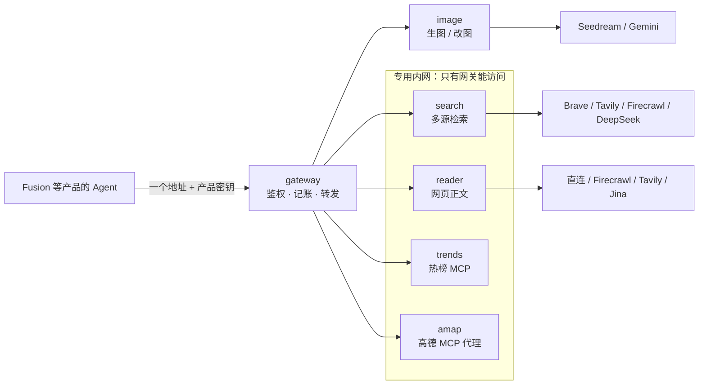

# agent-tools

给 AI Agent 用的工具服务：生图 / 改图、联网搜索、网页正文读取、热榜查询。调用方只配一个地址和一把产品密钥，由网关统一鉴权、记账和转发。[Fusion](https://github.com/HyxiaoGe/fusion) 的生图、联网搜索和网页读取都由这里提供。

| 服务 | 做什么 | 接口 |
|---|---|---|
| [gateway](gateway/README.md) | 统一入口：产品密钥鉴权、逐请求记账、按路径转发 | HTTP |
| [image](services/image/README.md) | 多模型生图与改图，参考图、搜索增强、缓存与限流 | REST + MCP |
| [search](services/search/README.md) | 网页 / 新闻 / 图片搜索，换搜索源只改配置 | REST + MCP |
| [reader](services/reader/README.md) | 输入 URL 返回 Markdown 正文，读不到时给出结构化原因 | REST |
| [trends](services/trends/README.md) | 国内热榜与 RSS 查询（TrendRadar），补齐上游工具契约 | MCP |
| [amap](services/amap/README.md) | 高德地图：地理编码、地点搜索、路线规划（官方 MCP 的代理，服务端持有密钥、只放行只读工具） | MCP |

## 设计要点

### 身份只来自密钥，下游不各自鉴权

网关按 `Authorization` 里的产品密钥认定调用方，再按产品配置放行服务（付费服务要逐个产品写明才可调用），丢弃调用方自带的身份头再重写转发，下游收到的产品、用户、场景都可信。search / reader / trends / amap 自身不做鉴权，只接入专用内网，外部和其他容器都只能经网关访问；路径里含 `.` / `..` 段一律拒绝，防止借公开前缀绕过鉴权。每个请求记一行用量（产品、用户、场景、请求 ID、MCP 工具名、耗时），可以按产品、场景和工具统计调用量。

### 慢服务不拖垮其他服务

网关给每个上游独立的连接池和超时。某个服务堆积慢请求时，只有它返回 `503 upstream_busy` 或 `504 upstream_timeout`，其他服务照常响应。

### 网页读取：先免费，慢了再并行付费

Agent 常并行读多个网页、要等最慢的那个，所以一次读取总时限 10 秒：

1. 先直连抓取（DoH 解析并确认是公网地址，trafilatura 提取正文），免费；
2. 1.5 秒还没结果，同时请求 Firecrawl 和 Tavily，直连继续跑，谁先拿到正文用谁；
3. 原网页确定 404/410 时立即返回 `page_not_found`，Agent 不再重试这个来源；
4. Jina 只做兜底，并识别它包装成 200 的错误页，错误页不当正文。

选 Firecrawl 做主力有实测依据：同一批 120 个网址，Firecrawl 中位耗时 4.3 秒、Jina 8.6 秒，两者读到真正正文的页数相当，而 Jina 读到的页里约一成是错误页。三家都支持多个 key：账户级失败（失效、欠费、限流）只冷却出错的那把并立即换下一把，页面级失败不消耗 key。

### 生图：多模型、可降级、不重复花钱

Seedream 与 Gemini 统一成一个接口，主模型被内容审核拦截时自动换备用模型。相同请求缓存 7 天，并发的相同请求只生成一次；按全局、产品、用户三级限流，参考图只允许公网地址。

### 不改上游代码，修正工具契约

热榜服务用官方 TrendRadar MCP 镜像，在外面加一层中间件：上游参数的可选值只写在说明文字里，模型常猜错，这里把它们补成 `enum`；上游出错时不标记错误，调用方会当成成功，这里改为工具错误。调用方用白名单只授权查询类工具，触发抓取、发通知等有副作用的工具不开放给模型。

## 工程

- Python 3.11+ / FastAPI / FastMCP / Redis / SQLite，每个服务独立依赖、独立镜像，服务之间不互相 import
- 400 多个测试用例，PR 只检查有改动的服务（ruff + pytest）
- 合入 `main` 后由 Windows 构建机构建镜像推到镜像仓库，dev 服务器只拉镜像部署；详见 [部署与运维](docs/operations.md)
